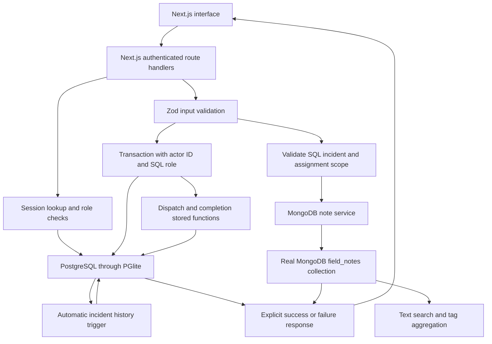

# CrisisLink system architecture

## Components and trust boundaries

The browser renders forms, operational tables, role-appropriate actions, notes and the SQL explorer. It does not connect to either database directly. Next.js route handlers authenticate the HttpOnly session cookie, validate inputs and return bounded results. SQL values use bound parameters and SQL explorer queries are allowlisted.

The SQL service sets the authenticated actor ID and an allowlisted PostgreSQL role inside each transaction. These NOLOGIN group roles trust the backend identity established from the stored session; they are not separate end-user database logins. GRANT/REVOKE and stored-function permissions restrict operations, and the maintenance policy independently checks the author ID. Password hashes and session token hashes are not granted to operational roles.

MongoDB stores field-note documents containing an SQL incident ID, session-derived author ID, text, tags, flexible assessment fields and timestamps. The API validates SQL references and assignment scope before writing a note and checks ownership before editing/deleting it. MongoDB schema validation and indexes are defined independently of SQL.

## Transaction and failure behavior

Semantic incident search extends the existing PostgreSQL branch with pgvector. The same Next.js backend runs a pinned MiniLM model locally, stores 384-dimensional vectors on emergencies, and queries cosine distance using a real HNSW-capable index. No extra database/server/API provider is introduced. Missing/outdated descriptions are indexed before search; inference runs outside SQL transactions and conditional updates avoid stale writes. A BEFORE description-update trigger invalidates the old embedding. Model failures affect semantic search only. MongoDB remains the field-note document database with keyword search. See COURSE_ALIGNMENT.md.

Incident creation and its requirement rows share one SQL transaction. A trigger-created history row belongs to that same transaction. Dispatch locks the incident, resource and responder; checks availability and capability coverage; then inserts and reserves them atomically. Completion records the report and releases the resource/responder together. Partial unique indexes reject overlapping active reservations.

SQL and MongoDB have independent transaction boundaries. Notes are not silently treated as committed if MongoDB fails. The API returns an error and allows retry. The offline test runs an isolated app against an unavailable MongoDB address and verifies both the error and continued SQL access. No distributed atomic commit or automatic retry/outbox mechanism is claimed.

## Deployment and secret handling

The supported deployment is one local Next.js process, a filesystem-backed PGlite database and a separate MongoDB process bound to loopback. `pnpm setup` accepts a hidden password, persists only scrypt hashes and revokes existing demo sessions. Runtime configuration uses environment variables. No plaintext bootstrap password file is generated. Sessions persist only token hashes.

The local MongoDB helper has no network exposure beyond loopback and does not configure authentication. Public GitHub publication shares source and fictional evidence only; it does not publish a running database. A hosted deployment requires authenticated MongoDB/TLS, HTTPS, managed secrets, a suitable PostgreSQL server architecture and a deployment-specific security review.
