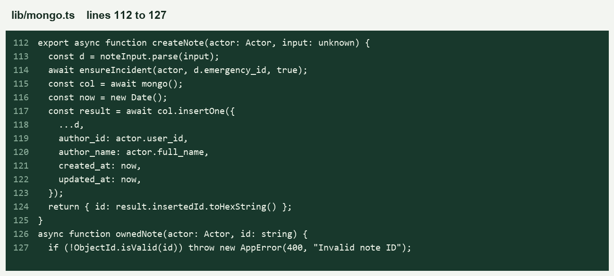
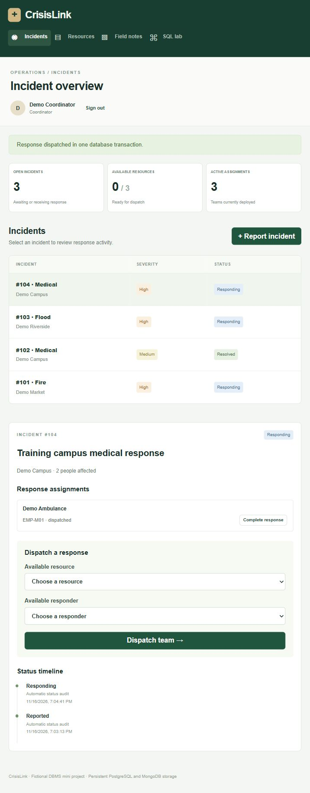

DBMS Mini Project Report

Crisis Link

Emergency Resource Coordination &amp; Response Management System

Course TitleDatabase Management Systems

Course CodeUE24CS351A

| Student Name | Student SRN |
|---|---|
| Sachin R | PES1UG24CS688 |
| Abhinav Krishna Kandukuri | PES1UG24CS701 |

26 November 2026


---

2 Abstract

CrisisLink is an emergency response management application that connects incidents, locations, responders and resources through a relational database. Coordinators record incidents and dispatch available teams. Responders complete their assigned responses, while technicians record maintenance activity. The application keeps operational history and prevents conflicting active assignments.

The project combines PostgreSQL, executed through PGlite, with MongoDB. PostgreSQL maintains the structured operational records and enforces keys, constraints, transactions and access permissions. MongoDB stores flexible field notes with tags and assessment details. The Next.js interface connects both databases through authenticated APIs. The implementation includes stored functions, an automatic audit trigger, nested and correlated queries, CTEs, a recursive query, a view and supporting indexes.

The initial relational dataset contains 63 fictional records across 17 domain tables. Three internal tables support sessions, login throttling and report-decision receipts. The system is a local classroom demonstration and does not connect to emergency services.

A course-aligned extension adds duplicate-report review using PostgreSQL pgvector, a pinned local MiniLM model, 384-dimensional embeddings, cosine distance and an HNSW index. MongoDB field-note search remains a separate keyword-search feature.

2.1 Problem statement

Emergency response coordination must keep incident information, team availability, equipment allocation and field updates consistent. Separate lists and messages can obscure which team is responsible or whether a resource is already occupied. CrisisLink connects these records and implements an auditable training workflow from reporting to dispatch and completion.

2.2 Objectives

The objectives are to model operational relationships with explicit keys and constraints; prevent conflicting assignments through transactions; record status changes automatically; preserve flexible searchable field assessments in a document database; and enforce three user roles through a functional web interface and database permissions.


---

2.3 Scope and functional requirements

The supported scope is one local classroom deployment with fictional data. It includes incident reporting, exclusive dispatch, completion reports, maintenance, SQL resource-tag CRUD, document-note CRUD and search, and live SQL examples. Real emergency communication, multi-process SQL hosting, multi-resource quantity optimization and distributed transactions are outside this implementation.

| ID | Functional requirement | Acceptance condition |
|---|---|---|
| FR01 | Authenticate accounts | Valid credentials create expiring sessions; logout revokes them. |
| FR02 | Enforce roles | Three roles; forbidden API and direct SQL operations fail. |
| FR03 | Report incidents | Validated incident and capability requirement save together. |
| FR04 | Audit status changes | One trigger entry per new incident or actual status change. |
| FR05 | Dispatch a response | Availability/capability checks and reservations are atomic. |
| FR06 | Reject allocation conflicts | Conflicting active assignments leave no partial update. |
| FR07 | Complete a response | Owned assignment creates a report and releases the team. |
| FR08 | Record maintenance | Allowed role and correct author identity; nonnegative cost. |
| FR09 | Manage SQL resource tags | Resources screen supports create read rename and remove. |
| FR10 | Manage MongoDB notes | Incident links, assignment scope and ownership are validated. |
| FR11 | Search and aggregate | Indexed text/tag search and incident tag counts execute. |
| FR12 | Explore SQL queries | JOIN, subquery, CTE/window, recursive and view queries run. |
| FR13 | Report database failures | No success response for an unconfirmed database save. |
| FR14 | Protect passwords | Hidden setup input; only salted hashes persist. |
| FR15 | Demonstrate DDL safely | CREATE ALTER DROP run against a temporary object. |
| FR16 | Review duplicate reports | Metadata filters and real vectors suggest candidates; coordinator attaches or creates separately. |


---

3 Tech Stack

| Technology | Role and justification |
|---|---|
| Next.js 16.4.6 and React 19.3.1 | App Router interface and server-side route handlers in one project. |
| TypeScript 7.0.2 and Zod 4.6.7 | Typed modules and server validation of incident, authentication and note inputs. |
| PostgreSQL through PGlite 0.5.16 | Relational integrity, stored functions, triggers, roles and transactions without installing a separate SQL server. |
| pgvector 0.8.7 and MiniLM | Real vector(384) storage, HNSW cosine index and locally generated semantic embeddings. Transformers.js 3.8.1 runs pinned model weights. |
| MongoDB Community Server 8.2 | A real document database for variable note assessments, indexed search and aggregation. |
| MongoDB Node driver 7.9.0 | Server-side connection and document CRUD; no browser database credentials. |
| Node.js 24 and pnpm | Local runtime, locked dependencies, build and test commands. |
| Node crypto and node:test | Scrypt password hashing, random sessions and automated integration checks. |

3.1 System architecture

The browser communicates only with the Next.js API. SQL services use role-scoped transactions. The field-note service validates SQL incident references before writing to MongoDB. Each database has its own transaction boundary; cross-database atomic commit is not claimed. Database configuration comes from environment variables.


---

4 SQL Database Commands

4.1 Database design

The relational design retains the supplied classroom model. Assignments connect an emergency to one response resource and one responder. Junction relations represent incident requirements and resource capabilities. Multivalued skills and tags are stored in separate relations with composite primary keys. Conceptual priority_score and available_capacity attributes are not stored in this version.

The supporting DATA_DICTIONARY.md and schema-metadata.json are generated from an executed fresh database and document every attribute, SQL type, nullability, identity, key, check and index. Internal session and login-attempt tables are documented separately from the domain model.

| Domain relations | Primary key |
|---|---|
| roles | role_id |
| users | user_id |
| emergency_types | type_id |
| locations | location_id |
| emergencies | emergency_id |
| emergency_status_history | history_id |
| capabilities | capability_id |
| emergency_required_capabilities | emergency_id + capability_id |
| responders | responder_id |
| resource_types | type_id |
| resources | resource_id |
| resource_capabilities | resource_id + capability_id |
| assignments | assignment_id |
| maintenance_records | maintenance_id |
| responder_reports | report_id |
| responder_skills | responder_id + skill |
| resource_tags | resource_id + tag |

The following two sheets retain the complete supplied Chen ER diagram and connected relational schema. The application adds stronger nullability and uniqueness rules, timezone-aware event timestamps, role permissions and internal authentication tables. These extensions are specified in database/02_advanced.sql and explained below.


---

4.2 DDL and integrity constraints

database/00_schema.sql defines the domain tables in dependency order. Single-column identifiers use PostgreSQL identity columns. Seed IDs remain explicit; initialization advances each identity sequence beyond the seeded maximum. Event timestamps use TIMESTAMPTZ and Indian local time for interpreting the supplied sample values.

```
CREATE TABLE resource_tags (
    resource_id INTEGER NOT NULL,
    tag VARCHAR(100) NOT NULL,
    CONSTRAINT pk_resource_tags PRIMARY KEY(resource_id, tag),
    CONSTRAINT fk_resource_tags FOREIGN KEY(resource_id)
      REFERENCES resources(resource_id)
      ON DELETE NO ACTION ON UPDATE NO ACTION
);

ALTER TABLE users ADD CONSTRAINT uq_users_email UNIQUE(email);
ALTER TABLE users ALTER COLUMN email SET NOT NULL;
ALTER TABLE emergencies ALTER COLUMN reported_by SET NOT NULL;
ALTER TABLE emergencies ADD CONSTRAINT ck_severity
  CHECK(severity_level IN ('low','medium','high','critical'));
ALTER TABLE emergencies ADD CONSTRAINT ck_status
  CHECK(status IN ('reported','responding','resolved'));
ALTER TABLE emergencies ADD CONSTRAINT ck_time
  CHECK(updated_at >= reported_at);

CREATE UNIQUE INDEX uq_active_resource ON assignments(resource_id)
  WHERE status IN ('active','dispatched');
CREATE UNIQUE INDEX uq_active_responder ON assignments(responder_id)
  WHERE status IN ('active','dispatched');
```

| Rule | Effect |
|---|---|
| 26 domain foreign keys | Referenced parent rows must exist. Deletion does not cascade. |
| 10 domain CHECK constraints | Reject invalid coordinates, negative values, invalid status/severity and reversed incident times. |
| Composite keys | Prevent duplicate incident requirements, capabilities, skills and tags. |
| Partial unique indexes | Permit historical assignments while preventing overlapping active use of a resource or responder. |
| Three internal tables | Sessions, login attempts and report-decision receipts support the application. |


---

4.3 DDL lifecycle and SQL tag operations

The following standalone demonstration creates, alters and drops only a temporary practice table. It does not remove operational data. The automated DDL test verifies the sample result and confirms that the temporary table no longer exists afterward.

```
-- Isolated temporary-object DDL demonstration. Does not drop application data.
BEGIN;
CREATE TEMPORARY TABLE crisislink_ddl_example (
    example_id INTEGER PRIMARY KEY,
    label VARCHAR(80) NOT NULL
);
ALTER TABLE crisislink_ddl_example
    ADD COLUMN quantity INTEGER NOT NULL DEFAULT 1 CHECK(quantity > 0);
INSERT INTO crisislink_ddl_example(example_id,label) VALUES(1,'DDL practice');
SELECT * FROM crisislink_ddl_example;
DROP TABLE crisislink_ddl_example;
COMMIT;
```

Resource tag CRUD in the application

The Resources screen lets coordinators and technicians add a resource tag, inspect current tags, rename one and remove one. These actions execute SQL INSERT, SELECT, UPDATE and DELETE through the API. Responders retain read-only tag access; direct responder SQL deletion is also rejected.

```
INSERT INTO resource_tags(resource_id,tag) VALUES($1,$2);
SELECT resource_id,tag FROM resource_tags ORDER BY resource_id,tag;
UPDATE resource_tags SET tag=$1 WHERE resource_id=$2 AND tag=$3;
DELETE FROM resource_tags WHERE resource_id=$1 AND tag=$2;
GRANT INSERT,UPDATE,DELETE ON resource_tags
  TO crisis_coordinator,crisis_technician;
```

The service binds all values as parameters, validates tag length and resource IDs, and returns 404 when an expected tag is missing. Primary and foreign keys reject duplicate tags and unknown resources.


---

4.4 DML operations and joins

The seed is inserted transactionally using database/01_seed.sql. Application INSERT and UPDATE statements bind values as parameters. The following tag demonstration exercises all four CRUD operations and then restores the starting state.

```
BEGIN;
INSERT INTO resource_tags(resource_id,tag) VALUES(201,'temporary_demo');
UPDATE resource_tags SET tag='updated_demo'
  WHERE resource_id=201 AND tag='temporary_demo';
SELECT * FROM resource_tags
  WHERE resource_id=201 AND tag='updated_demo';
DELETE FROM resource_tags
  WHERE resource_id=201 AND tag='updated_demo';
ROLLBACK;
```

Incident type and location join

```
SELECT e.emergency_id,t.type_name,l.location_name,e.status
FROM emergencies e
JOIN emergency_types t USING(type_id)
JOIN locations l USING(location_id)
ORDER BY e.emergency_id;
```

| Emergency | Type | Location | Seed status |
|---|---|---|---|
| 101 | Fire | Demo Market | responding |
| 102 | Medical | Demo Campus | resolved |
| 103 | Flood | Demo Riverside | responding |

Aggregation

```
SELECT e.emergency_id,COUNT(a.assignment_id) AS assignment_count
FROM emergencies e LEFT JOIN assignments a USING(emergency_id)
GROUP BY e.emergency_id
HAVING COUNT(a.assignment_id)>=1;
```

Each of the three supplied emergencies has one assignment. LEFT JOIN also allows incidents with no assignment to participate before HAVING filters the groups. Demonstration-created records appear in the live results in addition to these seed rows.


---

4.5 Nested correlated and recursive queries

A scalar subquery computes one overall average. The outer query retrieves incidents whose affected-person count is greater than that average.

```
SELECT emergency_id,people_affected FROM emergencies
WHERE people_affected > (SELECT AVG(people_affected) FROM emergencies);
```

For the untouched seed, the average is 34/3. Emergencies 101 and 103 satisfy the condition. A correlated NOT EXISTS query instead refers to each outer emergency and checks whether any active assignment exists.

```
SELECT e.emergency_id,e.status FROM emergencies e
WHERE NOT EXISTS (
  SELECT 1 FROM assignments a
  WHERE a.emergency_id=e.emergency_id
    AND a.status IN ('active','dispatched')
);
```

CTE and window function

```
WITH ranked AS (
  SELECT history_id,emergency_id,status,changed_at,
    ROW_NUMBER() OVER(
      PARTITION BY emergency_id
      ORDER BY changed_at DESC,history_id DESC
    ) AS rn
  FROM emergency_status_history
)
SELECT * FROM ranked WHERE rn=1;
```

Recursive reporting calendar

```
WITH RECURSIVE days(day) AS (
  SELECT CURRENT_DATE-6
  UNION ALL SELECT day+1 FROM days WHERE day<CURRENT_DATE
)
SELECT d.day,COUNT(e.emergency_id) AS incident_count
FROM days d LEFT JOIN emergencies e ON e.reported_at::DATE=d.day
GROUP BY d.day ORDER BY d.day;
```

The recursive CTE produces seven dates. LEFT JOIN retains days with zero incidents, making a complete daily reporting interval.


---

4.6 Stored dispatch function

The following function is implemented in database/02_advanced.sql. It rejects unavailable resources and responders before writing the assignment and related status changes. The calling service wraps execution in a role-scoped transaction.

```
CREATE FUNCTION dispatch_response(p_emergency INTEGER,p_resource INTEGER,p_responder INTEGER)
RETURNS INTEGER LANGUAGE plpgsql SECURITY DEFINER SET search_path=public,pg_temp AS $$
DECLARE new_id INTEGER; e emergencies; r resources; p responders;
BEGIN
  SELECT * INTO e FROM emergencies WHERE emergency_id=p_emergency FOR UPDATE;
  IF NOT FOUND OR e.status='resolved' THEN RAISE EXCEPTION 'Incident is missing or resolved' USING ERRCODE='P0001'; END IF;
  SELECT * INTO r FROM resources WHERE resource_id=p_resource FOR UPDATE;
  IF NOT FOUND OR r.status<>'available' THEN RAISE EXCEPTION 'Resource is unavailable' USING ERRCODE='P0001'; END IF;
  SELECT * INTO p FROM responders WHERE responder_id=p_responder FOR UPDATE;
  IF NOT FOUND OR p.status<>'available' THEN RAISE EXCEPTION 'Responder is unavailable' USING ERRCODE='P0001'; END IF;
  IF EXISTS(SELECT 1 FROM emergency_required_capabilities c
    WHERE c.emergency_id=p_emergency AND NOT EXISTS(
      SELECT 1 FROM resource_capabilities rc WHERE rc.resource_id=p_resource
      AND rc.capability_id=c.capability_id)) THEN
    RAISE EXCEPTION 'Resource does not cover required capabilities' USING ERRCODE='P0001';
  END IF;
  INSERT INTO assignments(emergency_id,resource_id,responder_id,assigned_by,assigned_at,dispatch_time,status,remarks)
  VALUES(p_emergency,p_resource,p_responder,app_actor(),CURRENT_TIMESTAMP,CURRENT_TIMESTAMP,'dispatched','Dispatched through application')
  RETURNING assignment_id INTO new_id;
  UPDATE resources SET status='assigned' WHERE resource_id=p_resource;
  UPDATE responders SET status='on_duty' WHERE responder_id=p_responder;
  UPDATE emergencies SET status='responding',updated_at=CURRENT_TIMESTAMP WHERE emergency_id=p_emergency;
  RETURN new_id;
END;
$$;
```


---

4.7 Response completion and automatic trigger

dispatch_response(emergency, resource, responder) locks the selected rows, rejects missing or unavailable entities, verifies required capability coverage and inserts an assignment. It then reserves the resource and responder and changes the incident to responding. All changes run in one SQL transaction. Partial unique indexes also reject conflicting active assignments.

```
-- Called only under the coordinator database role
SELECT dispatch_response(104,202,2);
-- Called by the assigned responder or coordinator
SELECT finish_response(304,'Patients transferred safely');
```

finish_response checks assignment ownership, creates an assignment-linked report, marks the assignment completed and releases the resource and responder. It resolves the incident only when no active assignments remain. These are PostgreSQL stored functions, not TypeScript functions labelled as database routines.

Status history trigger definition

```
CREATE FUNCTION record_emergency_status() RETURNS TRIGGER
LANGUAGE plpgsql SECURITY DEFINER
SET search_path=public,pg_temp AS $$
BEGIN
  IF TG_OP='INSERT' OR OLD.status IS DISTINCT FROM NEW.status THEN
    INSERT INTO emergency_status_history
      (emergency_id,status,remarks,changed_by,changed_at)
    VALUES(NEW.emergency_id,NEW.status,'Automatic status audit',
           app_actor(),CURRENT_TIMESTAMP);
  END IF;
  RETURN NEW;
END;
$$;
CREATE TRIGGER trg_emergency_status
AFTER INSERT OR UPDATE OF status ON emergencies
FOR EACH ROW EXECUTE FUNCTION record_emergency_status();
```

The trigger creates exactly one history entry for a new incident or an actual status change. Updating a status to its existing value creates no extra entry. History is rolled back with the operational change if the surrounding transaction fails.

View and supporting index

```
SELECT * FROM v_assignment_summary ORDER BY assignment_id;
CREATE INDEX idx_history_time
  ON emergency_status_history(emergency_id,changed_at DESC);
```


---

4.8 Authentication and database role access

The interface authenticates synthetic user accounts by email and password. Passwords use scrypt with independent random salts. The browser receives a random session token in an HttpOnly SameSite Strict cookie; SQL stores only its SHA-256 hash and an eight-hour expiry. Logout removes the stored token hash. Repeated failed logins trigger a temporary block.

| Role | Permitted application actions |
|---|---|
| Coordinator | Read operational data; create incidents; dispatch and complete responses; manage field notes; record maintenance. |
| Responder | Read operational data; complete only own assignments; add notes only to assigned incidents; edit/delete own notes. Resource tags are read-only. |
| Technician | Read operational data and field notes; record maintenance under own user identity; add rename and remove SQL resource tags. |

```
CREATE ROLE crisis_coordinator NOLOGIN;
CREATE ROLE crisis_responder NOLOGIN;
CREATE ROLE crisis_technician NOLOGIN;
REVOKE EXECUTE ON ALL FUNCTIONS IN SCHEMA public FROM PUBLIC;
GRANT EXECUTE ON FUNCTION dispatch_response(INTEGER,INTEGER,INTEGER)
  TO crisis_coordinator;
GRANT EXECUTE ON FUNCTION finish_response(INTEGER,TEXT)
  TO crisis_coordinator,crisis_responder;

ALTER TABLE maintenance_records ENABLE ROW LEVEL SECURITY;
CREATE POLICY maintenance_author ON maintenance_records FOR INSERT
  TO crisis_coordinator,crisis_technician
  WITH CHECK(performed_by=app_actor());
```

After authenticating the session, the backend sets app.user_id and an allowlisted PostgreSQL role within a transaction. These group roles have no login credentials and trust the backend to establish the correct actor. Responders and technicians receive no direct incident-writing permission, and operational roles cannot read password hashes or session tokens.

Authorization is applied in the interface, API service layer and SQL grants/functions. The maintenance policy independently rejects a technician record attributed to another user. SECURITY DEFINER functions use a fixed search path, and execution is granted only to the required roles. SQL parameters are bound; the query explorer accepts only named predefined queries.


---

4.9 Vector search for duplicate-report review

Several callers may describe the same emergency differently. Creating a separate incident for each report fragments information and can lead to repeated coordination. CrisisLink now uses vector search inside Report incident to suggest possible existing incidents before the coordinator chooses to attach the information or create a separate incident. The standalone similar-incidents panel has been removed.

The existing React, Next.js API, PostgreSQL/PGlite and MongoDB architecture is retained. This follows the course pgvector/MiniLM/cosine/HNSW lesson (PDF pages 681 and 697-709). PostgreSQL stores the canonical incident and vector index. MongoDB stores a confirmed additional report as an incident-linked observation, not as a second emergency.

```
CREATE EXTENSION IF NOT EXISTS vector;
ALTER TABLE emergencies ADD COLUMN IF NOT EXISTS
  embedding vector(384);
ALTER TABLE emergencies ADD COLUMN IF NOT EXISTS
  embedding_model VARCHAR(160);
ALTER TABLE emergencies ADD COLUMN IF NOT EXISTS
  embedded_at TIMESTAMPTZ;
CREATE INDEX IF NOT EXISTS idx_emergency_embedding_hnsw
  ON emergencies USING hnsw (embedding vector_cosine_ops)
  WHERE embedding IS NOT NULL;
```

The pinned local MiniLM model uses mean pooling, normalization and all 384 dimensions. Incident descriptions and incoming reports use the same model revision. Weights are cached under data/models; inference needs no hosted embedding API. Missing/outdated vectors are generated outside SQL transactions and saved only if the source description remains unchanged. A BEFORE description-update trigger invalidates stale vectors.

```
WITH nearest AS MATERIALIZED (
  SELECT e.*, embedding <=> $1::vector AS cosine_distance
  FROM emergencies e
  WHERE location_id=$2 AND status IN ('reported','responding')
    AND reported_at>=CURRENT_TIMESTAMP-INTERVAL '24 hours'
    AND reported_at<=CURRENT_TIMESTAMP
    AND embedding IS NOT NULL AND embedding_model=$3
  ORDER BY embedding <=> $1::vector LIMIT 5
)
SELECT emergency_id,description,cosine_distance FROM nearest
ORDER BY cosine_distance;
```

The runtime query also joins incident types and deployed-team details. Only candidates with cosine distance at most 0.65 are shown. This is a screening heuristic, not calibrated confidence or proof of identity. Location, time and active status limit scope; other locations, older events or approximate-index misses remain possible. HNSW is approximate and small data may use an exact scan. The coordinator decides; no report is automatically merged or suppressed.


---

4.10 Human decisions, retry safety and live results

The form sends POST /api/incidents/review with the complete draft. The coordinator sees candidate descriptions, types, times, status and active assignments. Review creates no incident, assignment or note. The signed ten-minute review token binds the draft, user and candidate fingerprints. Form edits invalidate displayed results; tampered, expired or changed reviews fail.

| Human choice | Result |
|---|---|
| Same incident: attach report | POST /api/incidents/report preserves the original incoming description and reported details as a MongoDB additional-report note. No incident or dispatch is created; canonical counts/severity remain unchanged. |
| Different incident: create separately | Creates a new SQL incident and automatic history, even when a possible match exists. The coordinator retains responsibility for distinguishing events. |
| Duplicate check unavailable | The form offers explicit creation without the check. Model failure is never silently substituted with keyword results. |

app_incident_report_receipts is an internal SQL table recording the chosen action and request identity. New incident creation and its receipt share one transaction. MongoDB has a unique partial index on report_review_id, and attachment uses an idempotent upsert. Retrying the same decision does not create another note or incident; switching that review to a different action is rejected. Attachment rechecks candidate eligibility and source text before saving.

SQL and MongoDB do not share a distributed transaction. A SQL attachment receipt is a decision record, not proof of MongoDB success. MongoDB failure returns an explicit error; retry the same decision while valid. A server restart invalidates outstanding signed reviews, requiring a new check. The base domain still has 17 tables and 26 domain foreign keys; vector columns and three internal tables are implementation extensions listed in the dictionary.

Live SQL lab

Every query executes against current PostgreSQL records. The tab runs the selected query immediately, refreshes every five seconds while open, offers Refresh results now and shows the server execution timestamp. Errors clear old results. The recursive CTE now uses CURRENT_DATE-6 through CURRENT_DATE in the database timezone rather than fixed demo dates.

For the demonstration, create a current warehouse-fire report, then enter the differently worded storage-building report at the same location. Review and attach it; show the original text in Field notes and unchanged incident/assignment counts. For a separate report choose create separately, then open SQL lab. JOIN and latest-history CTE show its new ID; the rolling calendar count rises. Views/grouping change after dispatch. Filtered queries only show records meeting their predicates.

```
pnpm vector:setup  # Stop app before standalone SQL access
pnpm mongo         # First terminal
pnpm dev           # Second terminal
# Optional read-only review through the running API:
pnpm vector:search "A storage building is burning" 1 1
```

COURSE_ALIGNMENT.md explains slide references, metadata filters, CTE, cosine distance, HNSW limits, token/receipt lifecycle and outage behaviour. Native MongoDB vector search is not claimed; MongoDB retains field-note CRUD, text search and aggregation and now supports retry-safe additional-report observations. On a larger deployment, embedding maintenance should move to a background worker.


---

5 NoSQL Database Commands

5.1 Collection creation and validation

MongoDB stores field notes because their assessment details can vary across incidents. Each note links to a SQL emergency ID and an authenticated author. The collection stores text, tags, assessment details and creation/update dates. PostgreSQL remains responsible for structured response relationships.

```
db = db.getSiblingDB('crisislink');
db.createCollection('field_notes', {
  validator: { $jsonSchema: {
    bsonType: 'object',
    required: ['emergency_id','author_id','author_name','text',
      'tags','assessment','created_at','updated_at'],
    properties: {
      emergency_id: {bsonType:'int',minimum:1},
      author_id: {bsonType:'int',minimum:1},
      author_name: {bsonType:'string'},
      text: {bsonType:'string',minLength:5,maxLength:2000},
      tags: {bsonType:'array',maxItems:8,
        items:{bsonType:'string'}},
      assessment: {bsonType:'object'},
      created_at: {bsonType:'date'},
      updated_at: {bsonType:'date'}
    }
  }}, validationAction:'error'
});
db.field_notes.createIndex({emergency_id:1,created_at:-1});
db.field_notes.createIndex({text:'text',tags:'text'});
```

The compound index supports incident-specific chronological retrieval. The text index supports word search across note text and tags. Collection validation rejects malformed direct writes, while Zod also checks API input length and assessment fields. The createCollection command is for a fresh database; the application initializes it automatically when needed.

Cross database integrity

Before inserting a note, the API checks the referenced SQL incident, role and responder assignment. Updates cannot change the incident ID. The author or coordinator can edit/delete a note. Incident deletion is not exposed by the application. SQL and MongoDB do not share a distributed transaction; database failures are shown as failed operations and never as successful saves.


---

5.2 Document CRUD search and aggregation

```
// CREATE
const noteId = db.field_notes.insertOne({
  emergency_id:101,author_id:1,author_name:'Demo Coordinator',
  text:'Training evacuation route checked and clear',
  tags:['safety','training'],assessment:{safety:'Route clear'},
  created_at:new Date(),updated_at:new Date()
}).insertedId;

// READ
db.field_notes.find({emergency_id:101}).sort({created_at:-1});

// UPDATE
db.field_notes.updateOne({_id:noteId},{$set:{
  text:'Training evacuation completed safely',updated_at:new Date()
}});

// FULL TEXT SEARCH
db.field_notes.find({emergency_id:101,
  $text:{$search:'evacuation'}});

// AGGREGATION
db.field_notes.aggregate([
  {$match:{emergency_id:101}},
  {$unwind:'$tags'},
  {$group:{_id:'$tags',count:{$sum:1}}},
  {$sort:{count:-1}}
]);

// DELETE only the disposable demonstration document
db.field_notes.deleteOne({_id:noteId});
```

In the application, a successful save returns the inserted ObjectId. Search results are limited to 100 notes for the selected incident. The aggregation counts tags for that incident; a note tagged medical and safety contributes one count to each tag. The interface provides creation, search, editing and deletion controls according to role and ownership.

MongoDB is a separate running database process. Its persistence is independent of the PostgreSQL directory. The local helper binds to loopback port 27028. A remote deployment would require authenticated MongoDB connections, TLS, HTTPS and managed secrets; the delivered configuration is intended for local evaluation.


---

6 Next js Project Tree Structure

```
crisislink-app/
  app/
    layout.tsx                 Root layout and metadata
    page.tsx                   Login and operational interface
    globals.css                Responsive styles
    api/[...path]/route.ts      Authenticated API dispatcher
  lib/
    db.ts                      SQL initialization and role transactions
    auth.ts                    Login sessions and role checks
    password.ts                Scrypt and token hashing
    service.ts                 Incidents dispatch completion SQL lab
    embeddings.ts              Pinned local MiniLM vector generation
    semantic.ts                Incremental embedding maintenance
    incident-review.ts         Filtered vector review and human decisions
    mongo.ts                   Validation notes CRUD search aggregation
  database/
    00_schema.sql              PostgreSQL domain DDL
    01_seed.sql                63 supplied fictional seed rows
    02_advanced.sql            Functions trigger roles RLS indexes
    03_queries.sql             DML JOIN subquery CTE examples
    04_mongo_commands.js       MongoDB setup and demonstrations
    05_resource_tag_permissions.sql  Role grants for tag CRUD
    06_ddl_demo.sql             Isolated CREATE ALTER DROP demo
    07_vector_search.sql        pgvector HNSW and invalidation trigger
    08_report_receipts.sql       Internal retry/decision records
    mysql/                     Original classroom SQL and outputs
  scripts/
    mongo.mjs                  Dedicated local MongoDB launcher
    setup.ts                   Hidden input hash only account setup
    secret-input.mjs           Non echoing terminal input
    export-schema.ts           Generate the SQL data dictionary
    vector-setup.ts            Cache model and backfill incident vectors
    http-smoke.mjs             Running API checks
  tests/integration.test.ts     Isolated SQL and MongoDB checks
  package.json                 Dependencies and runnable commands
  pnpm-lock.yaml               Reproducible package versions
  README.md                    Setup demonstration and limitations
```

Request flow

The authenticated API validates each request and calls the SQL, semantic-search or MongoDB service. JSON success/error responses update the interface; note writes also validate SQL references.

| Command | Purpose |
|---|---|
| pnpm install --frozen-lockfile | Install locked dependencies |
| pnpm setup | Initialize/reset accounts with hidden password input |
| pnpm vector:setup | Cache the model and backfill incident vectors |
| pnpm mongo | Start local MongoDB in the first terminal |
| pnpm dev | Start the app at 127.0.0.1:3100 |
| pnpm build and pnpm start | Build and run in production mode |
| pnpm typecheck and pnpm test | Check TypeScript and database integration |


---

6.1 Backend and database integration

| HTTP route | Operation |
|---|---|
| POST /api/auth/login | Verify password and create a hashed-token session. |
| GET /api/auth/me | Resolve the current authenticated user and role. |
| POST /api/auth/logout | Revoke the session. |
| GET /api/dashboard | Retrieve incidents, resources, assignments, history and reference records. |
| POST /api/incidents/review | Read-only duplicate review using filters and pgvector. |
| POST /api/incidents/report | Coordinator confirms attachment or separate incident creation. |
| POST /api/incidents | Coordinator creates incident and required capability. |
| POST /api/dispatch | Coordinator invokes the atomic dispatch SQL function. |
| POST /api/complete | Assigned responder or coordinator completes a response. |
| POST /api/maintenance | Coordinator or technician inserts maintenance. |
| POST PATCH DELETE /api/resource-tags | Coordinator or technician adds renames or removes SQL tags. |
| GET /api/queries?key=cte | Run an allowlisted live SQL example. |
| GET and POST /api/notes | Read/search or create MongoDB field notes. |
| PATCH and DELETE /api/notes/:id | Edit or delete an authorized field note. |

Transaction boundaries

Incident creation and its capability requirement are one SQL transaction. Dispatch and completion also group related changes. For example, if an incident requirement references a missing capability, both the incident and its trigger-generated history entry roll back. A failed conflicting dispatch leaves no partial assignment or reservation.

Session and request protections

Operational endpoints return 401 without a valid session. Role violations return 403, invalid inputs return 400, and database conflicts return 409. Writes reject a mismatched Origin host. Cookies are not exposed to JavaScript. Password fields, password hashes and raw session tokens are excluded from operational API responses.

Persistent local storage

PostgreSQL files are stored under data/postgres and MongoDB files under data/mongo. Run pnpm setup before starting the app and choose a password using hidden input. Setup persists only scrypt hashes, revokes prior demo sessions and creates no plaintext password file. Runtime data, real credentials, dependencies and build outputs are excluded from the source archive and Git history. Only one app process should open a PGlite directory at a time.


---

7 Application Code and Demo

7.1 Application code excerpts

The following figures reproduce the implementation source. The API excerpt authenticates the session before operational routes. The MongoDB excerpt validates SQL access before storing the note and derives its author from the session.

Figure 1 Application route handler excerpt

Figure 2 MongoDB note creation source excerpt


---

7.2 Incident and field note demonstration

The browser demonstration created incident 104 at Demo Campus, dispatched the ambulance and medical responder, and saved a field update to MongoDB. The left capture shows the active assignment and automatic history entries. The right capture shows the saved document, tags and assessment. Captures use the responsive interface at the available browser width.


---

7.3 Live SQL results and verification

The SQL lab executes predefined queries against the application database. The latest-history CTE returns one ranked event per incident, including the newly created demonstration incident. Its displayed four-row result is a live app result, not the untouched three-incident seed.

Figure 5 CTE query and recorded application result

Verification performed

The integration suite passed 23 named checks against isolated PostgreSQL and MongoDB data. Additional tests cover temporary-object DDL, SQL tag CRUD and permission denial, hash-only bootstrap persistence and secure setup/reset. The combined runner passed 41 tests (39 named checks plus two parents), including real-vector review/decision tests and live SQL-lab new-data verification. Seven additional HTTP checks cover review, attachment, signed drafts, current results and outage behaviour. The HTTP suite passed 12 checks. Type checking and the production build passed.

Two outage checks verified an unavailable MongoDB endpoint returns an explicit failure while the SQL dashboard remains available. Browser captures document coordinator login, incident creation, dispatch, a persisted field note and live SQL results.

Checks include key and CHECK enforcement, transaction rollback, one audit entry per status change, assignment ownership, SQL permission denial, maintenance row policies, MongoDB validation, note ownership, text search, aggregation, cookie/session behavior, logout and cross-origin rejection. Full check names and results are included with the source package.

The application is a local evaluation system. Multi-process SQL access, production deployment, real emergency communication and distributed cross-database transactions are outside its current scope.

Technical references

Next.js authentication · PGlite documentation · PostgreSQL row security · MongoDB schema validation


---

7.4 Conclusion and future enhancements

CrisisLink connects relational design and document storage to a response workflow. An incident is reported, a compatible resource and responder are reserved atomically, the assigned team records completion, and the resource becomes available again. PostgreSQL enforces relationships, conflicts and audit behavior. MongoDB supplies flexible incident-linked field updates with indexed retrieval and tag aggregation.

The implementation goes beyond separate CRUD forms through transaction boundaries, automatic triggers, stored functions, database permissions, ownership checks and tested failure behavior. The Resources screen provides explicit SQL resource-tag CRUD. A disposable DDL example demonstrates CREATE, ALTER and DROP without dropping operational data.

| Future enhancement | Purpose |
|---|---|
| Hosted PostgreSQL and deployment hardening | Support multi-process service operation with managed secrets and infrastructure. |
| Authenticated MongoDB and TLS | Prepare database connections for hosted operation beyond the loopback demo. |
| Multi-resource allocation | Allocate capability quantities across several response units. |
| Cross-database outbox and retries | Coordinate eventual field updates without claiming distributed atomic commit. |
| Maps and broader duplicate-report retrieval | Improve location selection and refine the implemented review using location precision and evaluation data. |

These enhancements are future work. The delivered application remains a fictional single-process local demonstration and does not connect to emergency services.

Supporting project documentation

PROJECT_SPECIFICATION.md records the full problem, objectives, scope and functional requirements. DATA_DICTIONARY.md and schema-metadata.json describe the executed schema. ARCHITECTURE.md explains trust and failure boundaries. The separate Level 3 audit and rubric checklist record evidence coverage. The repository README provides installation, secure setup, demonstration and test commands.


---

7.5 Team responsibilities and contribution records

The following division assigns database and application responsibilities to both team members. Completed contributions are recorded separately in CONTRIBUTIONS.md using actual dates, changes, reviews, test results and student commit links.

| Work area | Sachin R | Abhinav Krishna Kandukuri |
|---|---|---|
| Data design | ER and relational model; keys, cardinalities, constraints and SQL dictionary. | MongoDB note model; SQL/document references, indexes and retrieval strategy. |
| Database work | Schema/seed review, safe DDL, SQL tag CRUD and incident-history trigger. | Dispatch/completion stored functions, reporting view/indexes and MongoDB CRUD/search/aggregation. |
| Application work | Incident creation/detail/history and resource-tag/maintenance screens and APIs. | Login/session/role flow, dashboard, dispatch/completion and field-note screens and APIs. |
| Testing and security | SQL integrity, DDL/DML, audit history, rollback, maintenance policy and tag permissions. | Authentication, role/ownership enforcement, MongoDB validation, HTTP workflow and outage cases. |
| Documentation | Problem, objectives, scope, requirements, ER/schema, dictionary and SQL explanations. | Technology justification, architecture, NoSQL commands, setup, screenshots and integration evidence. |
| Viva focus | Relational design, queries, audit trigger and incident/resource/maintenance modules. | Database choices, functions, authentication, dispatch and MongoDB integration. |

Shared responsibilities

Both members independently run the application, review and test each other's modules, verify the report against the demonstrated version, rehearse the complete workflow and maintain evidence for their own actual work. Each should be able to explain a database component and an application component beyond their primary assigned area.

## Report figures







