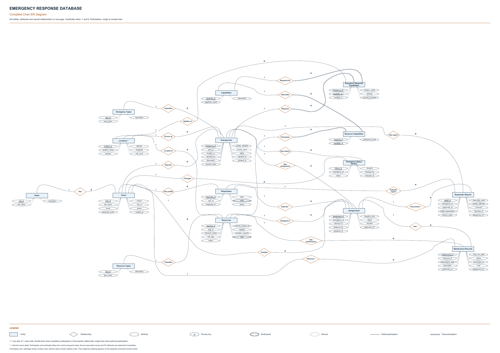
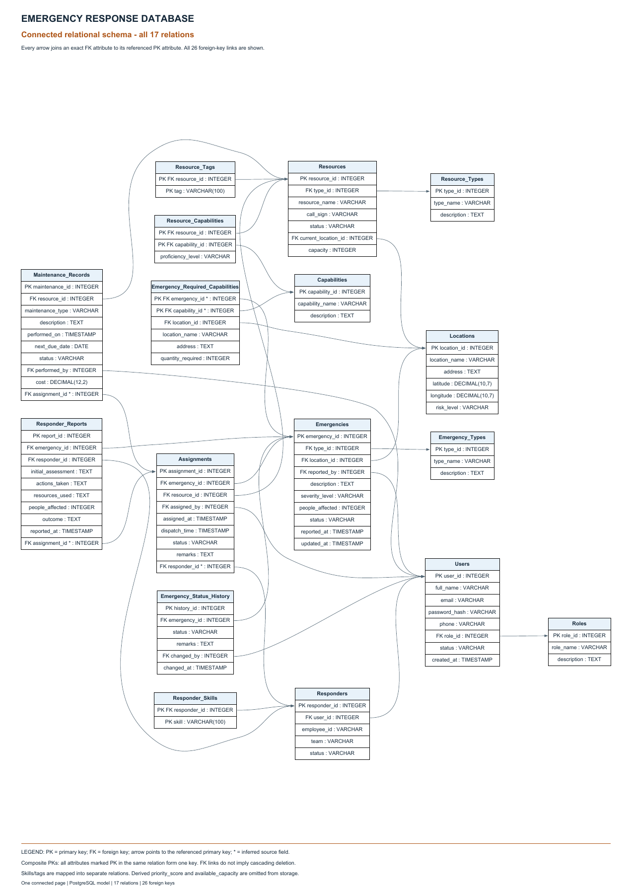
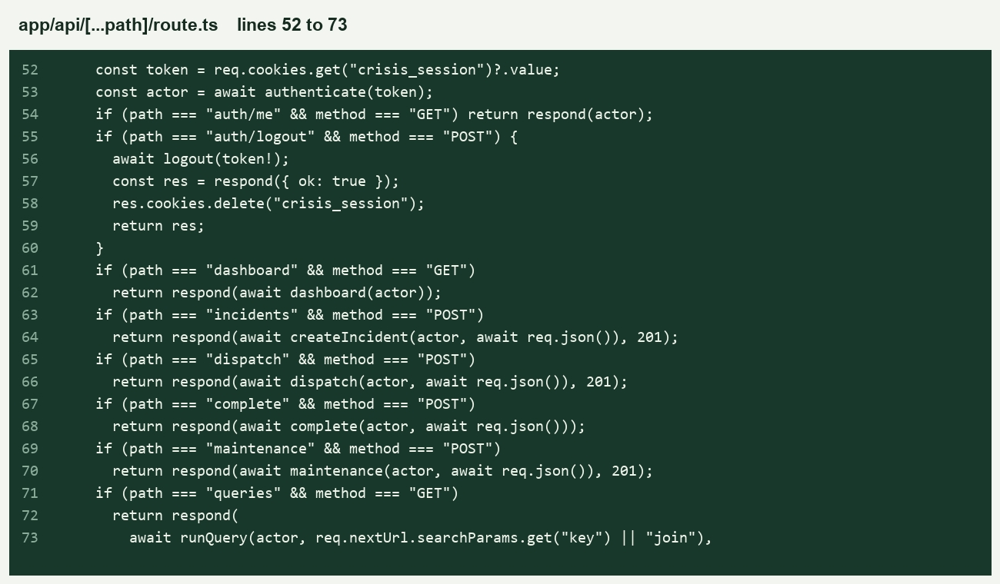
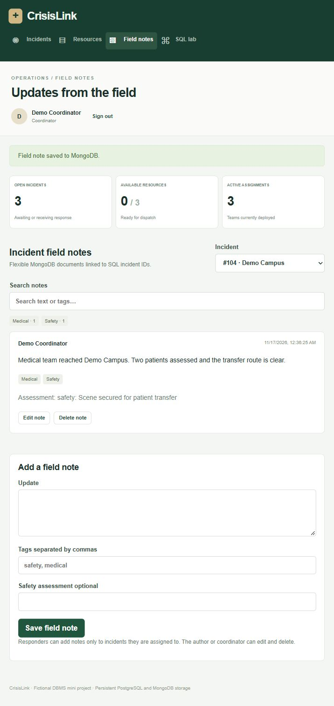
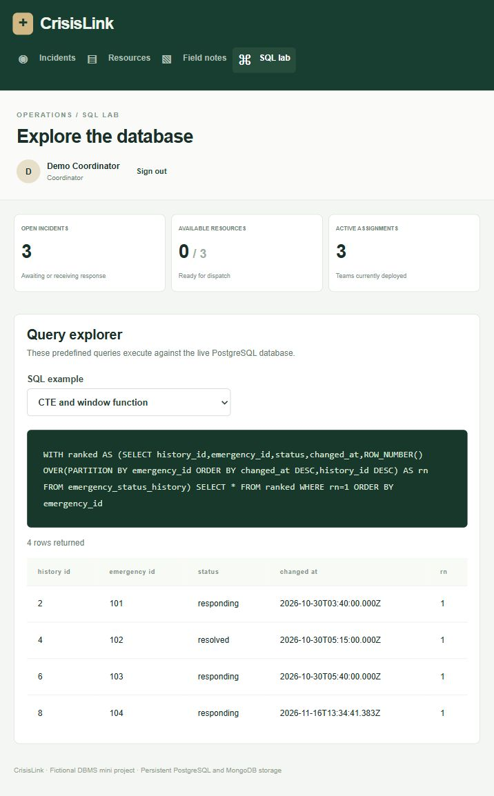

DBMS Mini Project Report

CrisisLink

Emergency Response Management System

Course TitleDatabase Management Systems

Course CodeUE24CS351A

| Student Name | Student SRN |
|---|---|
| Sachin R | PES1UG24CS688 |
| Abhinav Krishna Kandukuri | PES1UG24CS701 |

17 November 2026


---

2 Abstract

CrisisLink is an emergency response management application that connects incidents, locations, responders and resources through a relational database. Coordinators record incidents and dispatch available teams. Responders complete their assigned responses, while technicians record maintenance activity. The application keeps operational history and prevents conflicting active assignments.

The project combines PostgreSQL, executed through PGlite, with MongoDB. PostgreSQL maintains the structured operational records and enforces keys, constraints, transactions and access permissions. MongoDB stores flexible field notes with tags and assessment details. The Next.js interface connects both databases through authenticated APIs. The implementation includes stored functions, an automatic audit trigger, nested and correlated queries, CTEs, a recursive query, a view and supporting indexes.

The initial relational dataset contains 63 fictional records across 17 domain tables. Two additional internal tables support sessions and login throttling. The system is a local classroom demonstration and does not connect to emergency services.

3 Tech Stack

| Technology | Role and justification |
|---|---|
| Next.js 16.4.6 and React 19.3.1 | App Router interface and server-side route handlers in one project. |
| TypeScript 7.0.2 and Zod 4.6.7 | Typed modules and server validation of incident, authentication and note inputs. |
| PostgreSQL through PGlite 0.5.16 | Relational integrity, stored functions, triggers, roles and transactions without installing a separate SQL server. |
| MongoDB Community Server 8.2 | A real document database for variable note assessments, indexed search and aggregation. |
| MongoDB Node driver 7.9.0 | Server-side connection and document CRUD; no browser database credentials. |
| Node.js 24 and pnpm | Local runtime, locked dependencies, build and test commands. |
| Node crypto and node:test | Scrypt password hashing, random sessions and automated integration checks. |


---

4 SQL Database Commands

4.1 Database design

The relational design retains the supplied classroom model. Assignments connect an emergency to one response resource and one responder. Junction relations represent incident requirements and resource capabilities. Multivalued skills and tags are stored in separate relations with composite primary keys. Conceptual priority_score and available_capacity attributes are not stored in this version.

| Domain relations | Primary key |
|---|---|
| roles | role_id |
| users | user_id |
| emergency_types | type_id |
| locations | location_id |
| emergencies | emergency_id |
| emergency_status_history | history_id |
| capabilities | capability_id |
| emergency_required_capabilities | emergency_id + capability_id |
| responders | responder_id |
| resource_types | type_id |
| resources | resource_id |
| resource_capabilities | resource_id + capability_id |
| assignments | assignment_id |
| maintenance_records | maintenance_id |
| responder_reports | report_id |
| responder_skills | responder_id + skill |
| resource_tags | resource_id + tag |

The following two sheets retain the complete supplied Chen ER diagram and connected relational schema. The application adds stronger nullability and uniqueness rules, timezone-aware event timestamps, role permissions and internal authentication tables. These extensions are specified in database/02_advanced.sql and explained below.


---

4.2 DDL and integrity constraints

database/00_schema.sql defines the domain tables in dependency order. Single-column identifiers use PostgreSQL identity columns. Seed IDs remain explicit; initialization advances each identity sequence beyond the seeded maximum. Event timestamps use TIMESTAMPTZ and Indian local time for interpreting the supplied sample values.

```
CREATE TABLE resource_tags (
    resource_id INTEGER NOT NULL,
    tag VARCHAR(100) NOT NULL,
    CONSTRAINT pk_resource_tags PRIMARY KEY(resource_id, tag),
    CONSTRAINT fk_resource_tags FOREIGN KEY(resource_id)
      REFERENCES resources(resource_id)
      ON DELETE NO ACTION ON UPDATE NO ACTION
);

ALTER TABLE users ADD CONSTRAINT uq_users_email UNIQUE(email);
ALTER TABLE users ALTER COLUMN email SET NOT NULL;
ALTER TABLE emergencies ALTER COLUMN reported_by SET NOT NULL;
ALTER TABLE emergencies ADD CONSTRAINT ck_severity
  CHECK(severity_level IN ('low','medium','high','critical'));
ALTER TABLE emergencies ADD CONSTRAINT ck_status
  CHECK(status IN ('reported','responding','resolved'));
ALTER TABLE emergencies ADD CONSTRAINT ck_time
  CHECK(updated_at >= reported_at);

CREATE UNIQUE INDEX uq_active_resource ON assignments(resource_id)
  WHERE status IN ('active','dispatched');
CREATE UNIQUE INDEX uq_active_responder ON assignments(responder_id)
  WHERE status IN ('active','dispatched');
```

| Rule | Effect |
|---|---|
| 26 domain foreign keys | Referenced parent rows must exist. Deletion does not cascade. |
| 10 domain CHECK constraints | Reject invalid coordinates, negative values, invalid status/severity and reversed incident times. |
| Composite keys | Prevent duplicate incident requirements, capabilities, skills and tags. |
| Partial unique indexes | Permit historical assignments while preventing overlapping active use of a resource or responder. |
| Two internal tables | app_sessions references users; app_login_attempts records failed login attempts. |


---

4.3 DML operations and joins

The seed is inserted transactionally using database/01_seed.sql. Application INSERT and UPDATE statements bind values as parameters. The following tag demonstration exercises all four CRUD operations and then restores the starting state.

```
BEGIN;
INSERT INTO resource_tags(resource_id,tag) VALUES(201,'temporary_demo');
UPDATE resource_tags SET tag='updated_demo'
  WHERE resource_id=201 AND tag='temporary_demo';
SELECT * FROM resource_tags
  WHERE resource_id=201 AND tag='updated_demo';
DELETE FROM resource_tags
  WHERE resource_id=201 AND tag='updated_demo';
ROLLBACK;
```

Incident type and location join

```
SELECT e.emergency_id,t.type_name,l.location_name,e.status
FROM emergencies e
JOIN emergency_types t USING(type_id)
JOIN locations l USING(location_id)
ORDER BY e.emergency_id;
```

| Emergency | Type | Location | Seed status |
|---|---|---|---|
| 101 | Fire | Demo Market | responding |
| 102 | Medical | Demo Campus | resolved |
| 103 | Flood | Demo Riverside | responding |

Aggregation

```
SELECT e.emergency_id,COUNT(a.assignment_id) AS assignment_count
FROM emergencies e LEFT JOIN assignments a USING(emergency_id)
GROUP BY e.emergency_id
HAVING COUNT(a.assignment_id)>=1;
```

Each of the three supplied emergencies has one assignment. LEFT JOIN also allows incidents with no assignment to participate before HAVING filters the groups. Demonstration-created records appear in the live results in addition to these seed rows.


---

4.4 Nested correlated and recursive queries

A scalar subquery computes one overall average. The outer query retrieves incidents whose affected-person count is greater than that average.

```
SELECT emergency_id,people_affected FROM emergencies
WHERE people_affected > (SELECT AVG(people_affected) FROM emergencies);
```

For the untouched seed, the average is 34/3. Emergencies 101 and 103 satisfy the condition. A correlated NOT EXISTS query instead refers to each outer emergency and checks whether any active assignment exists.

```
SELECT e.emergency_id,e.status FROM emergencies e
WHERE NOT EXISTS (
  SELECT 1 FROM assignments a
  WHERE a.emergency_id=e.emergency_id
    AND a.status IN ('active','dispatched')
);
```

CTE and window function

```
WITH ranked AS (
  SELECT history_id,emergency_id,status,changed_at,
    ROW_NUMBER() OVER(
      PARTITION BY emergency_id
      ORDER BY changed_at DESC,history_id DESC
    ) AS rn
  FROM emergency_status_history
)
SELECT * FROM ranked WHERE rn=1;
```

Recursive reporting calendar

```
WITH RECURSIVE days(day) AS (
  SELECT DATE '2026-10-30'
  UNION ALL SELECT day+1 FROM days WHERE day<DATE '2026-11-05'
)
SELECT d.day,COUNT(e.emergency_id) AS incident_count
FROM days d LEFT JOIN emergencies e ON e.reported_at::DATE=d.day
GROUP BY d.day ORDER BY d.day;
```

The recursive CTE produces seven dates. LEFT JOIN retains days with zero incidents, making a complete daily reporting interval.


---

4.5 Stored dispatch function

The following function is implemented in database/02_advanced.sql. It rejects unavailable resources and responders before writing the assignment and related status changes. The calling service wraps execution in a role-scoped transaction.

```
CREATE FUNCTION dispatch_response(p_emergency INTEGER,p_resource INTEGER,p_responder INTEGER)
RETURNS INTEGER LANGUAGE plpgsql SECURITY DEFINER SET search_path=public,pg_temp AS $$
DECLARE new_id INTEGER; e emergencies; r resources; p responders;
BEGIN
  SELECT * INTO e FROM emergencies WHERE emergency_id=p_emergency FOR UPDATE;
  IF NOT FOUND OR e.status='resolved' THEN RAISE EXCEPTION 'Incident is missing or resolved' USING ERRCODE='P0001'; END IF;
  SELECT * INTO r FROM resources WHERE resource_id=p_resource FOR UPDATE;
  IF NOT FOUND OR r.status<>'available' THEN RAISE EXCEPTION 'Resource is unavailable' USING ERRCODE='P0001'; END IF;
  SELECT * INTO p FROM responders WHERE responder_id=p_responder FOR UPDATE;
  IF NOT FOUND OR p.status<>'available' THEN RAISE EXCEPTION 'Responder is unavailable' USING ERRCODE='P0001'; END IF;
  IF EXISTS(SELECT 1 FROM emergency_required_capabilities c
    WHERE c.emergency_id=p_emergency AND NOT EXISTS(
      SELECT 1 FROM resource_capabilities rc WHERE rc.resource_id=p_resource
      AND rc.capability_id=c.capability_id)) THEN
    RAISE EXCEPTION 'Resource does not cover required capabilities' USING ERRCODE='P0001';
  END IF;
  INSERT INTO assignments(emergency_id,resource_id,responder_id,assigned_by,assigned_at,dispatch_time,status,remarks)
  VALUES(p_emergency,p_resource,p_responder,app_actor(),CURRENT_TIMESTAMP,CURRENT_TIMESTAMP,'dispatched','Dispatched through application')
  RETURNING assignment_id INTO new_id;
  UPDATE resources SET status='assigned' WHERE resource_id=p_resource;
  UPDATE responders SET status='on_duty' WHERE responder_id=p_responder;
  UPDATE emergencies SET status='responding',updated_at=CURRENT_TIMESTAMP WHERE emergency_id=p_emergency;
  RETURN new_id;
END;
$$;
```


---

4.6 Response completion and automatic trigger

dispatch_response(emergency, resource, responder) locks the selected rows, rejects missing or unavailable entities, verifies required capability coverage and inserts an assignment. It then reserves the resource and responder and changes the incident to responding. All changes run in one SQL transaction. Partial unique indexes also reject conflicting active assignments.

```
-- Called only under the coordinator database role
SELECT dispatch_response(104,202,2);
-- Called by the assigned responder or coordinator
SELECT finish_response(304,'Patients transferred safely');
```

finish_response checks assignment ownership, creates an assignment-linked report, marks the assignment completed and releases the resource and responder. It resolves the incident only when no active assignments remain. These are PostgreSQL stored functions, not TypeScript functions labelled as database routines.

Status history trigger definition

```
CREATE FUNCTION record_emergency_status() RETURNS TRIGGER
LANGUAGE plpgsql SECURITY DEFINER
SET search_path=public,pg_temp AS $$
BEGIN
  IF TG_OP='INSERT' OR OLD.status IS DISTINCT FROM NEW.status THEN
    INSERT INTO emergency_status_history
      (emergency_id,status,remarks,changed_by,changed_at)
    VALUES(NEW.emergency_id,NEW.status,'Automatic status audit',
           app_actor(),CURRENT_TIMESTAMP);
  END IF;
  RETURN NEW;
END;
$$;
CREATE TRIGGER trg_emergency_status
AFTER INSERT OR UPDATE OF status ON emergencies
FOR EACH ROW EXECUTE FUNCTION record_emergency_status();
```

The trigger creates exactly one history entry for a new incident or an actual status change. Updating a status to its existing value creates no extra entry. History is rolled back with the operational change if the surrounding transaction fails.

View and supporting index

```
SELECT * FROM v_assignment_summary ORDER BY assignment_id;
CREATE INDEX idx_history_time
  ON emergency_status_history(emergency_id,changed_at DESC);
```


---

4.7 Authentication and database role access

The interface authenticates synthetic user accounts by email and password. Passwords use scrypt with independent random salts. The browser receives a random session token in an HttpOnly SameSite Strict cookie; SQL stores only its SHA-256 hash and an eight-hour expiry. Logout removes the stored token hash. Repeated failed logins trigger a temporary block.

| Role | Permitted application actions |
|---|---|
| Coordinator | Read operational data; create incidents; dispatch and complete responses; manage field notes; record maintenance. |
| Responder | Read operational data; complete only own assignments; add notes only to assigned incidents; edit/delete own notes. |
| Technician | Read operational data and field notes; record maintenance under own user identity. |

```
CREATE ROLE crisis_coordinator NOLOGIN;
CREATE ROLE crisis_responder NOLOGIN;
CREATE ROLE crisis_technician NOLOGIN;
REVOKE EXECUTE ON ALL FUNCTIONS IN SCHEMA public FROM PUBLIC;
GRANT EXECUTE ON FUNCTION dispatch_response(INTEGER,INTEGER,INTEGER)
  TO crisis_coordinator;
GRANT EXECUTE ON FUNCTION finish_response(INTEGER,TEXT)
  TO crisis_coordinator,crisis_responder;

ALTER TABLE maintenance_records ENABLE ROW LEVEL SECURITY;
CREATE POLICY maintenance_author ON maintenance_records FOR INSERT
  TO crisis_coordinator,crisis_technician
  WITH CHECK(performed_by=app_actor());
```

After authenticating the session, the backend sets app.user_id and an allowlisted PostgreSQL role within a transaction. These group roles have no login credentials and trust the backend to establish the correct actor. Responders and technicians receive no direct incident-writing permission, and operational roles cannot read password hashes or session tokens.

Authorization is applied in the interface, API service layer and SQL grants/functions. The maintenance policy independently rejects a technician record attributed to another user. SECURITY DEFINER functions use a fixed search path, and execution is granted only to the required roles. SQL parameters are bound; the query explorer accepts only named predefined queries.


---

5 NoSQL Database Commands

5.1 Collection creation and validation

MongoDB stores field notes because their assessment details can vary across incidents. Each note links to a SQL emergency ID and an authenticated author. The collection stores text, tags, assessment details and creation/update dates. PostgreSQL remains responsible for structured response relationships.

```
db = db.getSiblingDB('crisislink');
db.createCollection('field_notes', {
  validator: { $jsonSchema: {
    bsonType: 'object',
    required: ['emergency_id','author_id','author_name','text',
      'tags','assessment','created_at','updated_at'],
    properties: {
      emergency_id: {bsonType:'int',minimum:1},
      author_id: {bsonType:'int',minimum:1},
      author_name: {bsonType:'string'},
      text: {bsonType:'string',minLength:5,maxLength:2000},
      tags: {bsonType:'array',maxItems:8,
        items:{bsonType:'string'}},
      assessment: {bsonType:'object'},
      created_at: {bsonType:'date'},
      updated_at: {bsonType:'date'}
    }
  }}, validationAction:'error'
});
db.field_notes.createIndex({emergency_id:1,created_at:-1});
db.field_notes.createIndex({text:'text',tags:'text'});
```

The compound index supports incident-specific chronological retrieval. The text index supports word search across note text and tags. Collection validation rejects malformed direct writes, while Zod also checks API input length and assessment fields. The createCollection command is for a fresh database; the application initializes it automatically when needed.

Cross database integrity

Before inserting a note, the API checks the referenced SQL incident, role and responder assignment. Updates cannot change the incident ID. The author or coordinator can edit/delete a note. Incident deletion is not exposed by the application. SQL and MongoDB do not share a distributed transaction; database failures are shown as failed operations and never as successful saves.


---

5.2 Document CRUD search and aggregation

```
// CREATE
const noteId = db.field_notes.insertOne({
  emergency_id:101,author_id:1,author_name:'Demo Coordinator',
  text:'Training evacuation route checked and clear',
  tags:['safety','training'],assessment:{safety:'Route clear'},
  created_at:new Date(),updated_at:new Date()
}).insertedId;

// READ
db.field_notes.find({emergency_id:101}).sort({created_at:-1});

// UPDATE
db.field_notes.updateOne({_id:noteId},{$set:{
  text:'Training evacuation completed safely',updated_at:new Date()
}});

// FULL TEXT SEARCH
db.field_notes.find({emergency_id:101,
  $text:{$search:'evacuation'}});

// AGGREGATION
db.field_notes.aggregate([
  {$match:{emergency_id:101}},
  {$unwind:'$tags'},
  {$group:{_id:'$tags',count:{$sum:1}}},
  {$sort:{count:-1}}
]);

// DELETE only the disposable demonstration document
db.field_notes.deleteOne({_id:noteId});
```

In the application, a successful save returns the inserted ObjectId. Search results are limited to 100 notes for the selected incident. The aggregation counts tags for that incident; a note tagged medical and safety contributes one count to each tag. The interface provides creation, search, editing and deletion controls according to role and ownership.

MongoDB is a separate running database process. Its persistence is independent of the PostgreSQL directory. The local helper binds to loopback port 27028. A remote deployment would require authenticated MongoDB connections, TLS, HTTPS and managed secrets; the delivered configuration is intended for local evaluation.


---

6 Next js Project Tree Structure

```
crisislink-app/
  app/
    layout.tsx                 Root layout and metadata
    page.tsx                   Login and operational interface
    globals.css                Responsive styles
    api/[...path]/route.ts      Authenticated API dispatcher
  lib/
    db.ts                      SQL initialization and role transactions
    auth.ts                    Login sessions and role checks
    password.ts                Scrypt and token hashing
    service.ts                 Incidents dispatch completion SQL lab
    mongo.ts                   Validation notes CRUD search aggregation
  database/
    00_schema.sql              PostgreSQL domain DDL
    01_seed.sql                63 supplied fictional seed rows
    02_advanced.sql            Functions trigger roles RLS indexes
    03_queries.sql             DML JOIN subquery CTE examples
    04_mongo_commands.js       MongoDB setup and demonstrations
    mysql/                     Original classroom SQL and outputs
  scripts/
    mongo.mjs                  Dedicated local MongoDB launcher
    http-smoke.mjs             Running API checks
  tests/integration.test.ts     Isolated SQL and MongoDB checks
  .env.example                 Configuration names without secrets
  next.config.ts               Server packages and build tracing
  package.json                 Dependencies and runnable commands
  pnpm-lock.yaml               Reproducible package versions
  README.md                    Setup demonstration and limitations
```

Request flow

A user action reaches a same-origin Next.js route handler. The handler validates the request, authenticates the session and delegates to the SQL service or MongoDB note service. SQL operations run under the authenticated role. Note writes also validate their SQL references. The API returns an explicit success or error, and the interface refreshes the relevant database records.

| Command | Purpose |
|---|---|
| pnpm install --frozen-lockfile | Install locked dependencies |
| pnpm mongo | Start local MongoDB in the first terminal |
| pnpm dev | Start the app at 127.0.0.1:3100 |
| pnpm build and pnpm start | Build and run in production mode |
| pnpm typecheck and pnpm test | Check TypeScript and database integration |


---

6.1 Backend and database integration

| HTTP route | Operation |
|---|---|
| POST /api/auth/login | Verify password and create a hashed-token session. |
| GET /api/auth/me | Resolve the current authenticated user and role. |
| POST /api/auth/logout | Revoke the session. |
| GET /api/dashboard | Retrieve incidents, resources, assignments, history and reference records. |
| POST /api/incidents | Coordinator creates incident and required capability. |
| POST /api/dispatch | Coordinator invokes the atomic dispatch SQL function. |
| POST /api/complete | Assigned responder or coordinator completes a response. |
| POST /api/maintenance | Coordinator or technician inserts maintenance. |
| GET /api/queries?key=cte | Run an allowlisted live SQL example. |
| GET and POST /api/notes | Read/search or create MongoDB field notes. |
| PATCH and DELETE /api/notes/:id | Edit or delete an authorized field note. |

Transaction boundaries

Incident creation and its capability requirement are one SQL transaction. Dispatch and completion also group related changes. For example, if an incident requirement references a missing capability, both the incident and its trigger-generated history entry roll back. A failed conflicting dispatch leaves no partial assignment or reservation.

Session and request protections

Operational endpoints return 401 without a valid session. Role violations return 403, invalid inputs return 400, and database conflicts return 409. Writes reject a mismatched Origin host. Cookies are not exposed to JavaScript. Password fields, password hashes and raw session tokens are excluded from operational API responses.

Persistent local storage

PostgreSQL files are stored under data/postgres and MongoDB files under data/mongo. Generated local account credentials are stored in an ignored private data file. Runtime data, credentials, dependency folders and build outputs are excluded from the distributable source archive and Git history. Only one app process should open a PGlite directory at a time.


---

7 Application Code and Demo

7.1 Application code excerpts

The following figures reproduce the implementation source. The API excerpt authenticates the session before operational routes. The MongoDB excerpt validates SQL access before storing the note and derives its author from the session.

Figure 1 Application route handler excerpt

Figure 2 MongoDB note creation source excerpt


---

7.2 Incident and field note demonstration

The browser demonstration created incident 104 at Demo Campus, dispatched the ambulance and medical responder, and saved a field update to MongoDB. The left capture shows the active assignment and automatic history entries. The right capture shows the saved document, tags and assessment. Captures use the responsive interface at the available browser width.


---

7.3 Live SQL results and verification

The SQL lab executes predefined queries against the application database. The latest-history CTE returns one ranked event per incident, including the newly created demonstration incident. Its displayed four-row result is a live app result, not the untouched three-incident seed.

Figure 5 CTE query and recorded application result

Verification performed

The database integration suite passed 23 checks against an isolated PostgreSQL directory and a separate real MongoDB database. The HTTP suite passed 11 checks against the running application. Type checking and the production build passed. The browser flow verified coordinator login, incident creation, dispatch, a persisted field note and live SQL results.

Checks include key and CHECK enforcement, transaction rollback, one audit entry per status change, assignment ownership, SQL permission denial, maintenance row policies, MongoDB validation, note ownership, text search, aggregation, cookie/session behavior, logout and cross-origin rejection. Full check names and results are included with the source package.

The application is a local evaluation system. Multi-process SQL access, production deployment, real emergency communication and distributed cross-database transactions are outside its current scope.

Technical references

Next.js authentication · PGlite documentation · PostgreSQL row security · MongoDB schema validation

## Report figures











